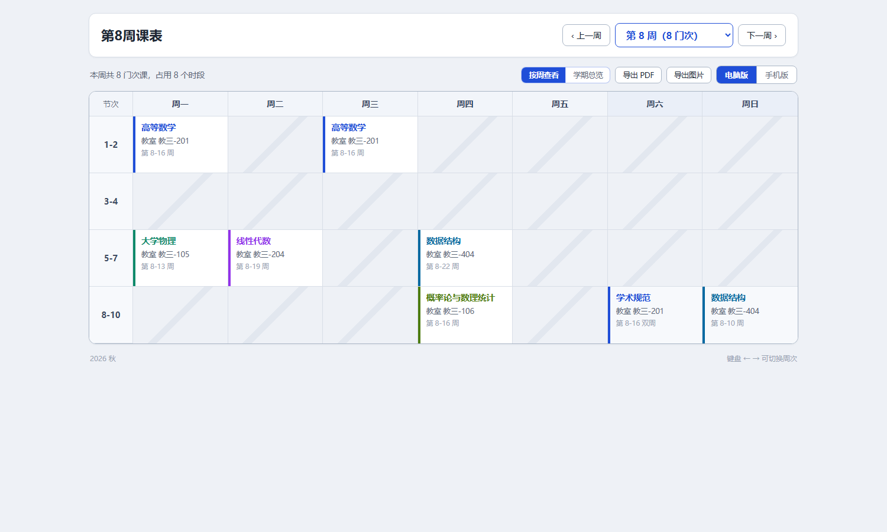
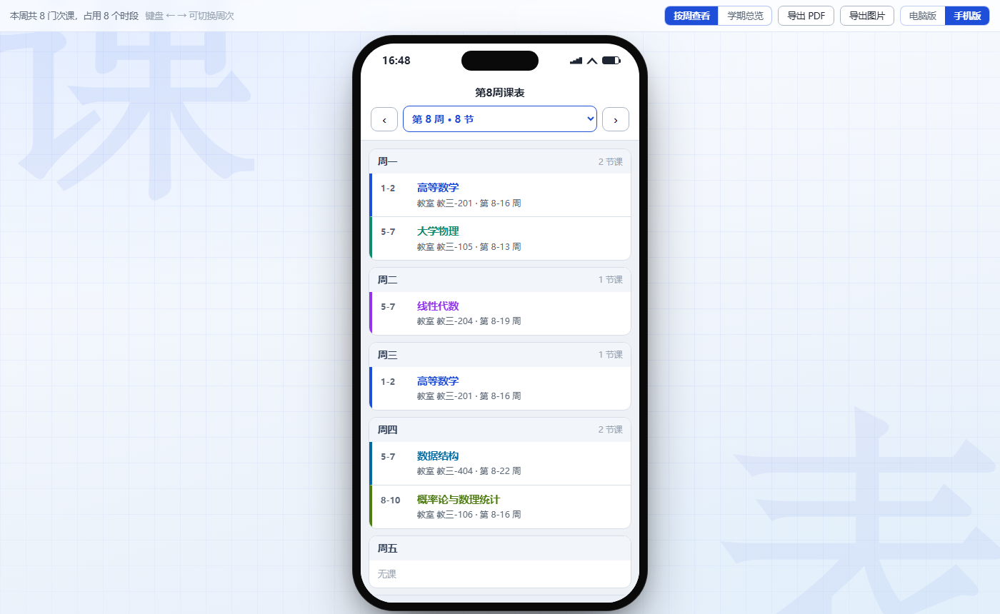
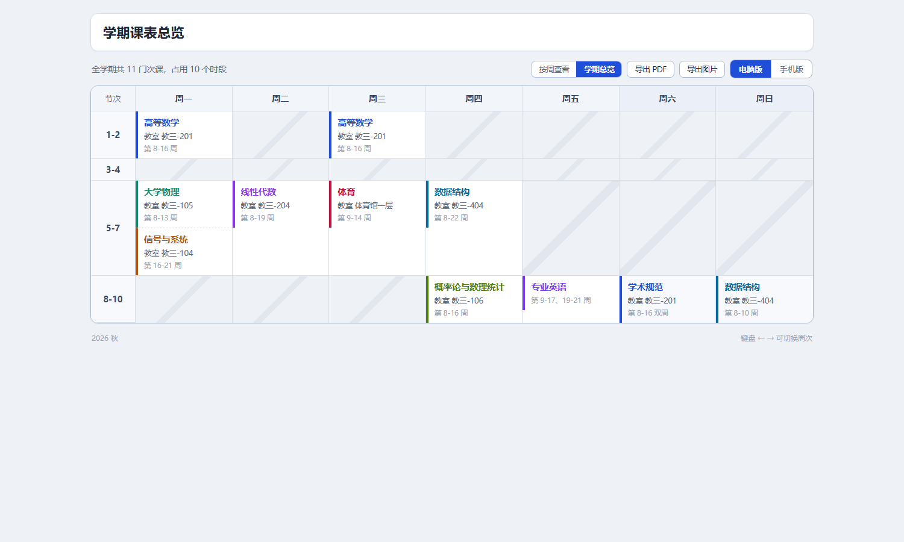

# course-timetable

> 把课程信息变成一张**单文件、离线、可打印**的课表网页的 AI agent skill。
> **按周查看 / 学期总览**一键切换，电脑版 / 手机版，可导出 PDF 和图片。



<table>
<tr>
<td width="50%"></td>
<td width="50%"></td>
</tr>
<tr>
<td align="center">手机版（真机自动铺满屏幕）</td>
<td align="center">学期总览（同一格多门课叠放，各带周次）</td>
</tr>
</table>

---

## 它解决什么问题

**课表的错是静默的**：周次写成 8-16 还是 8-15、课程名少一个字，页面照样好看、照样能导出、照样能打印。
用户要到开学第三周才发现。

所以这个 skill 的目标不是"生成一个网页"，而是**让每一环都能被证伪**：

| 门禁 | 做什么 | 通过标准 |
|---|---|---|
| ① 冲突探测 | `build_timetable.py --detect` 只检测、不写文件 | 退出码 0（有冲突就**不生成**，回去问用户） |
| ② 自检 + 视觉量测 | `check_timetable.py` / `render_weeks.js` / `verify_visual.py` | 前两个退出码 0，第三个不报几何越界 |
| ③ 独立核对 | 派一个**没看过 `spec.json`** 的 subagent 重新解析用户原话，逐条对撞 | 逐条判定一致；派不出核对员时必须如实声明"未独立核对" |

第 ③ 条最容易省、也最不能省 —— 脚本最多能证明「产物 == spec」，
而「spec == 用户说的话」只有独立重解析的一方才能证明。

## 特性

- **两种看法**：按周查看（下拉选第 N 周）｜学期总览（全学期汇总，同格多课叠放、各带周次）
- **两种形态**：电脑版（横版表格）｜手机版（手机外观 + 按天卡片；真机 ≤560px 自动铺满屏幕）
- **两种导出**：PDF（纸张尺寸跟着当前状态走，手机版按周**保证一页**）｜PNG（纯 SVG→Canvas，2 倍分辨率，无外部库）
- **单文件、离线**：产物不联网、无外部资源、双击就能看，可以直接发群里
- **周次语法**：`8-16`、`9-17、19-21`、`8-16单`/`8-16双`、`8`，中文数字与「到/至/～」也认
- **冲突探测**：同一周、同一天、同一节次段里两门课 → 拒绝生成并提示
- **可降级**：没有 Node / 没有浏览器 → 跳过对应校验并**在交付消息里说明**，绝不假装验过
- **隐私默认值**：不写姓名（除非用户明确要求）、不写年级/班级、不设 `title` 字段

## 安装 / 使用

这是一个 **skill**：把整个目录放进你的 agent 的 skills 目录即可（例如 `~/.agents/skills/course-timetable/`），
然后对 agent 说「帮我做个课表」。也可以直接当命令行工具用：

```bash
# 1) 写一份 spec.json（格式见下）
# 2) 探测冲突（只检测，不写任何文件）
python scripts/build_timetable.py spec.json --detect

# 3) 生成（文件名自动避让，绝不覆盖既有文件）
python scripts/build_timetable.py spec.json

# 4) 自检
python scripts/check_timetable.py spec.json "课表.html"
node   scripts/render_weeks.js    "课表.html"
python scripts/verify_visual.py   "课表.html"     # 可选：真浏览器渲染 + 量几何
```

**依赖**：Python 3（只用标准库）必需；Node 与 Chrome/Edge/Chromium/Firefox 可选，缺了会自动降级。

### spec.json

```json
{
  "term": "2026 秋",
  "days": ["周一", "周二", "周三", "周四", "周五"],
  "blocks": ["1-2", "3-4", "5-8", "9-10"],
  "courses": [
    {"day":"周一","block":"1-2","name":"高等数学","room":"教三-201","teacher":"李老师","weeks":"8-16"},
    {"day":"周三","block":"5-8","name":"大学物理","room":"体育馆一层","weeks":"9-14、19-21"},
    {"day":"周五","block":"9-10","name":"专业英语","weeks":"8-16双"}
  ]
}
```

| 字段 | 说明 |
|---|---|
| `days` | 一周上几天（默认周一到周日全显示，周末当"有课"处理） |
| `blocks` | 节次段，就是表格的行（默认 `["1-2","3-4","5-7","8-10"]`） |
| `room` / `teacher` | 可缺；两个都没有时页面上那一行自动省略 |
| `who` | **默认不写**（标题就是「第8周课表」）；只有用户明确要求才加 |
| `term` | 只填学期（`2026 秋`），不要填 `2026级` |
| `minWeek` / `maxWeek` / `defaultWeek` | 可选，脚本会校验它们与课程周次不矛盾 |

## 目录结构

```
├── SKILL.md                        给 agent 的说明书（工作流 + 硬规则）
├── test-prompts.json               典型使用场景的测试 prompt
├── assets/timetable.template.html  网页模板（含 __DATA__ 占位符，无任何数据）
├── scripts/
│   ├── build_timetable.py          spec.json → HTML；同时是冲突检测器（--detect）
│   ├── check_timetable.py          spec ↔ HTML 一致性 / 逐周展开 / 冲突检查
│   ├── render_weeks.js             用页面真实脚本渲染 + UI 断言（DOM 桩）
│   ├── verify_visual.py            可选：真浏览器渲染 + 量几何（没有浏览器降级成人工清单）
│   └── spec_from_html.py           课表.html → spec.json（要改课表时把数据捞回来）
├── references/                     解析规则 / 核对 prompt / 页面说明 / 踩坑记录
├── tests/                          自检套件（205 项）+ 两个示例 spec
└── docs/                           预览图
```

## 自检

```bash
python tests/run_tests.py      # 结果: 205 通过 / 0 失败
```

套件里有**负向测试**（故意篡改产物，要求校验器必须报错）和一条**变异测试**
（改坏页面里的统计函数，要求 `render_weeks.js` 必须抓到）——
因为"断言本身是不是死的"只能靠"改坏了看它叫不叫"来证明。

## 设计取舍

- **为什么用 `spec.json` 做中间层**：它是唯一能被逐字段核对、能被脚本校验、还能从产物反解回来的形态。
- **为什么文件名自动避让**：绝不覆盖既有文件；目录里已经有 `课表.html` 时自动叫 `课表2.html`。
- **为什么 `--detect` 单独一步**：带冲突的课表页面**照样渲染得很好看**（同格多课会叠放），
  光看页面发现不了，必须在这一步拦住。
- **为什么默认显示周末**：很多学校周末有课；用户自己说"我们周末没课"才收掉。
- **为什么默认不写姓名**：大多数用户不会主动说名字，猜错了比不写更糟。

## License

[MIT](LICENSE)
